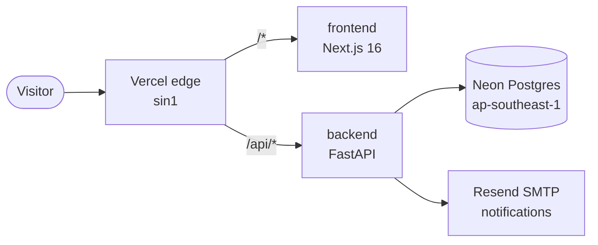

<p align="center">
  <picture>
    <source media="(prefers-color-scheme: dark)" srcset=".github/assets/logo-dark.svg">
    
  </picture>
</p>

<p align="center">
  <strong>From capacity to performance.</strong><br>
  Website and enquiry platform for the ARISE Leadership Transformation Programme Series.
</p>

<p align="center">
  <a href="#architecture">Architecture</a> ·
  <a href="#getting-started">Getting started</a> ·
  <a href="#configuration">Configuration</a> ·
  <a href="#deployment">Deployment</a> ·
  <a href="#security-and-privacy">Security</a>
</p>

---

## Overview

GameChanger Institute runs an ICF-informed leadership programme: twelve weeks of mentorship by serving board members and C-suite leaders, positive psychology support, and follow-up at three and six months. This repository holds the public website and the API that receives registrations of interest from individuals and organisations.

| | |
|---|---|
| **Site** | Home, Programme, For organisations, The Institute, Register interest, Privacy |
| **Registration** | Individual, corporate and general enquiries, stored in Postgres and emailed to the Institute |
| **Staff console** | `/admin`: invite-only 6-digit email sign-in; review and delete enquiries, record status changes with an audit trail, publish news, and manage staff access |
| **Experience** | Light and dark themes, video hero, smooth scrolling, scroll-driven 3D motion, full reduced-motion support |
| **Quality bar** | WCAG AA contrast in both themes, keyboard operable, no horizontal overflow from 360 px up |

## Architecture

One Vercel project, two services that build and deploy together. Public traffic enters a single route table: `/api/*` reaches the API with the prefix removed, everything else reaches the site. Same origin, so no CORS on the production path.



| Layer | Technology |
|---|---|
| Frontend | Next.js 16 (App Router), React 19, TypeScript, Tailwind CSS 4, Lenis |
| Backend | Python 3.14, FastAPI, SQLAlchemy 2 (asyncpg), Alembic, Pydantic 2 |
| Data | PostgreSQL (Neon): enquiries, audit history, news posts, staff accounts and sessions, rate-limit windows |
| Email | SMTP with STARTTLS (Resend) |
| Staff identity | Self-hosted: Postgres staff allowlist, HMAC-hashed 6-digit email codes via Resend, revocable server sessions |
| Platform | Vercel Services, functions in Singapore (`sin1`) |

## Repository structure

```text
.
├── frontend/                 Next.js site
│   ├── src/app/              Routes, root layout, globals.css (the only stylesheet)
│   ├── src/components/       layout/ sections/ figures/ forms/ ui/  (one component per file)
│   ├── src/content/          All copy and data, typed
│   ├── src/lib/              API client, validation, theme
│   └── public/               Optimised images and hero video
├── backend/                  FastAPI service
│   ├── app/                  API, settings, middleware, services, repositories
│   ├── migrations/           Alembic migrations
│   └── scripts/              Vercel build step (production migrations)
├── vercel.json               Services and public routing
└── .vercelignore             Upload exclusions
```

## Getting started

**Requirements:** Node.js 24, Python 3.14 with [uv](https://docs.astral.sh/uv/), PostgreSQL 16 or later.

```sh
# API
cd backend
cp .env.example .env                       # set DATABASE_URL, RATE_LIMIT_HASH_KEY
uv sync
uv run --env-file .env alembic upgrade head
uv run --env-file .env uvicorn app.main:create_app --factory --port 8000 --reload

# Site (second terminal)
cd frontend
cp .env.example .env.local                 # NEXT_PUBLIC_API_URL=http://localhost:8000
npm install
npm run dev                                # http://localhost:3000
```

Generate a rate-limit key with `python -c "import secrets; print(secrets.token_urlsafe(48))"`.

## Configuration

### Site

| Variable | Default | Purpose |
|---|---|---|
| `NEXT_PUBLIC_SITE_URL` | `https://gamechanger.institute` | Canonical URLs, sitemap, Open Graph |
| `NEXT_PUBLIC_API_URL` | `/api` | API base. Leave unset on Vercel; point at uvicorn locally |

### API

| Variable | Default | Purpose |
|---|---|---|
| `ENVIRONMENT` | `development` | `production` disables the OpenAPI docs |
| `DATABASE_URL` | required | Postgres URL; Neon's `postgresql://…?sslmode=require` form is accepted |
| `DATABASE_URL_UNPOOLED` | unset | Direct connection used by migrations |
| `DATABASE_POOL_SIZE` | `2` | `0` behind a transaction pooler such as Neon's |
| `RATE_LIMIT_HASH_KEY` | required | Secret, 32+ characters; keys the HMAC that identifies a client in the rate-limit table |
| `RATE_LIMIT_PER_IP` / `RATE_LIMIT_WINDOW_SECONDS` | `5` / `600` | Submissions allowed per client per window |
| `TRUSTED_CLIENT_IP_HEADER` | unset | `x-real-ip` on Vercel, which overwrites any client-supplied value |
| `CORS_ORIGINS` | `http://localhost:3000` | Exact origins, comma-separated |
| `SMTP_HOST` / `SMTP_PORT` / `SMTP_USERNAME` / `SMTP_PASSWORD` | unset / `587` | Notification transport; unset disables email |
| `MAIL_FROM` / `NOTIFY_TO` | unset | Sender and the Institute inbox |

The full list, with validation rules, is in [`backend/README.md`](backend/README.md).

## API

| Method | Path | Result |
|---|---|---|
| `POST` | `/api/v1/enquiries` | `202 {"id", "received_at"}`; errors as RFC 9457 `application/problem+json` |
| `GET` | `/api/healthz` | Liveness |
| `GET` | `/api/readyz` | Database readiness, `503` when it fails |
| `GET` | `/v1/admin/enquiries`, `/summary`, `/{id}` | Staff only, server to server from the console |
| `PATCH` | `/v1/admin/enquiries/{id}` | Staff only: change status with optimistic concurrency |

Submissions accept an `Idempotency-Key` header: a retry with the same key returns the original receipt instead of creating a second record.

## Deployment

Deployed on Vercel from this repository. Both services ship in one atomic deployment and roll back together.

1. **Production builds migrate first.** The backend build step runs `alembic upgrade head` when `VERCEL_ENV=production`. A failed migration fails the build, so code never goes live against a schema it does not match. Preview builds skip it.
2. **The database comes from the Vercel Marketplace.** Neon injects `DATABASE_URL` and `DATABASE_URL_UNPOOLED`; rate limiting uses the same database, so there is no second data store.
3. **Secrets are stored as Vercel sensitive variables.** They never live in the repository.

```sh
vercel deploy           # preview
vercel deploy --prod    # production
```

## Security and privacy

- **Headers:** a Content Security Policy (same-origin only, `frame-ancestors 'none'`), HSTS with preload, `nosniff`, a strict referrer policy, and a Permissions-Policy denying camera, microphone, geolocation and payment.
- **Data minimisation:** registrations store only what the form asks for, plus the consent timestamp and version. IP addresses and user agents are never stored. Rate limiting keys on an HMAC of the client IP that expires with its window.
- **Logs:** structured JSON with request IDs, and no names, emails, messages or IPs.
- **Abuse controls:** a per-client rate limit, a honeypot field, a 16 KiB body limit, and strict validation that rejects unknown fields and control characters.
- **Compliance:** written for Singapore's Personal Data Protection Act. The programme is described as ICF-informed, never as accredited or endorsed by the WHO.

## Design system

| | |
|---|---|
| Type | Newsreader for display, Source Sans 3 for text, self-hosted through `next/font` |
| Palette | Forest `#173f35`, Pine `#256650`, Sage `#c9ddd3`, Paper `#f6f3ec`, one accent in Terracotta `#c8553b` |
| Themes | Brand colours stay fixed. Role tokens (`canvas`, `fg`, `muted`, `line`, `accent`, `action`) switch between light and dark |
| Styling | Every rule lives in `frontend/src/app/globals.css`. Tailwind runs with `source(none)`, so markup carries class names only |

## License

[MIT](LICENSE)
